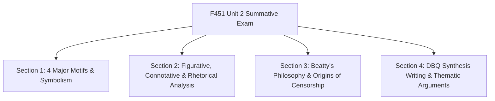
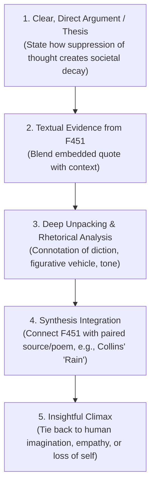

# Literature & Composition I Honors: Fahrenheit 451 Master Exam Guide
**Target Assessment**: *Fahrenheit 451* Unit 2 Summative Test  
**Test Dates**: Wednesday, October 28 / Thursday, October 29, 2026 (Block Days)  
**Instructor**: Ms. Jessica Grote | Room 1314 (`f43679@forsyth.k12.ga.us`)  
**Core Standard**: Analyze how figurative, connotative, and rhetorical language contributes to the development of meaning, tone, or mood in a text (ELAGSE9-10RL4 / RL1 / W1 / W2).  
**Primary Text on Disk**: [`/Volumes/Backup/Antony/HighSchool/Grade9/Literature-Comp-Honors/Unit02-The-Cost-of-Control/F451-Fahrenheit-451/Fahrenheit 451.pdf`](file:///Volumes/Backup/Antony/HighSchool/Grade9/Literature-Comp-Honors/Unit02-The-Cost-of-Control/F451-Fahrenheit-451/Fahrenheit%20451.pdf)

---

## 1. What You Need for This Exam (Checklist of Local Assets)

All necessary resources are archived locally:

- [x] **Full Unabridged Novel**: [`Fahrenheit 451.pdf`](file:///Volumes/Backup/Antony/HighSchool/Grade9/Literature-Comp-Honors/Unit02-The-Cost-of-Control/F451-Fahrenheit-451/Fahrenheit%20451.pdf) (152 pages, Ray Bradbury).
- [x] **Graphic Organizer & Analysis Pack**: [`Fahrenheit 451 Source Analysis Sheets.pdf`](file:///Volumes/Backup/Antony/HighSchool/Grade9/Literature-Comp-Honors/Unit02-The-Cost-of-Control/F451-Fahrenheit-451/Fahrenheit%20451%20Source%20Analysis%20Sheets.pdf).
- [x] **Part 3 Discussion & Analytical Questions**: [`F451_Part3_Discussion_Questions.txt`](file:///Volumes/Backup/Antony/HighSchool/Grade9/Literature-Comp-Honors/Unit02-The-Cost-of-Control/F451-Fahrenheit-451/F451_Part3_Discussion_Questions.txt).
- [x] **Censorship & Scene Thematic Matrix**: [`f451_censorship_scene_map.xlsx`](file:///Volumes/Backup/Antony/HighSchool/Grade9/Literature-Comp-Honors/Unit02-The-Cost-of-Control/F451-Fahrenheit-451/f451_censorship_scene_map.xlsx) / [`fahrenheit451_sheets.html`](file:///Volumes/Backup/Antony/HighSchool/Grade9/Literature-Comp-Honors/Unit02-The-Cost-of-Control/F451-Fahrenheit-451/fahrenheit451_sheets.html).
- [x] **DBQ Synthesis & Writing Architecture**: [`DBQ_Source_Analysis_and_Synthesis_Toolkit.md`](file:///Volumes/Backup/Antony/HighSchool/Grade9/Literature-Comp-Honors/Unit02-The-Cost-of-Control/DBQ-Summative-Writing-Oct14/DBQ_Source_Analysis_and_Synthesis_Toolkit.md).

---

## 2. Exam Blueprint: 4 Core Sections Tested

---

## 3. Deep-Dive Section 1: The 4 Major Motifs & Symbolism

### Motif 1: The Mechanical Hound
- **What it represents**: The perversion of science and technology into weapons of state surveillance and control; unnatural predators replacing living organisms.
- **Key Paradox**: *"The Mechanical Hound slept but did not sleep, lived but did not live in its gently humming, gently vibrating, softly illuminated kennel in a dark corner of the firehouse."*
- **Significance**:
  - Highlights the grotesque boundary between machine and animal.
  - Represents the programmed hostility toward individuality and non-conformity.
  - Senses Montag’s guilt/books before anyone else does (growling at him in Part 1).

### Motif 2: The Hearth and the Salamander
- **The Hearth (Traditional Fire)**: Historically represents the center of the home, warmth, nourishment, family togetherness, and civilization.
- **The Salamander (Mythological Fire)**: Ancient myth that the salamander lives in, feeds on, and is impervious to fire. In the novel, it is the official emblem of the firemen and etched onto their trucks.
- **The Irony & Conflict**:
  - In Montag's dystopian society, the "hearth" is replaced by television parlor walls that offer fake warmth while destroying real human intimacy.
  - The firemen wear the salamander badge to convince themselves they are invincible, yet fire ultimately consumes their own homes and lives.
  - Montag shifts from destructive fire (kerosene hose) to restorative fire (Granger’s campfire in the wilderness that warms rather than burns).

### Motif 3: The Sieve and the Sand
- **Origin of Symbol**: A childhood memory where Montag’s cruel cousin bet him a dime he couldn’t fill a sieve with sand on the beach. The faster he poured, the faster it slipped through the wire mesh.
- **Symbolic Meaning on the Subway**:
  - Montag sits on the vacuum subway train desperately trying to memorize the **Gospel of Matthew / Ecclesiastes**.
  - The loud, repetitive commercial blaring through the speakers (*"Denham’s Dentifrice, Denham’s Dandy Dental Detergent"*) drowns out his thoughts, causing the sacred words to slip from his mind.
- **Deeper Thematic Meaning**:
  - The **sand** represents tangible truth, literature, and genuine human knowledge.
  - The **sieve** represents the human mind inundated with relentless mass media, advertisement noise, and sensory overload.
  - Society deliberately engineers continuous distractions so that nobody can retain substantial thoughts long enough to challenge authority.

### Motif 4: The Phoenix
- **Mythological Reference**: A legendary bird that consumes itself in fire every few hundred years and rises reborn from its own ashes.
- **Granger's Monologue at the End of Part 3**:
  > *"There was a silly damn bird called a phoenix back before Christ, every few hundred years he built a pyre and burnt himself up... But every time he burnt himself up he sprang out of the ashes, he got himself born all over again. And it looks like we’re doing the same thing, over and over... But we’ve got one damn thing the phoenix never had. We know the damn silly thing we just did."*
- **Symbolic Significance**:
  - The war annihilates the city into a heap of atomic dust and ash in an instant.
  - Granger’s book-memorizing men represent the seed of humanity rising from the ashes of nuclear self-destruction.
  - Unlike the instinctive, brainless phoenix, humanity possesses the ability to **remember its history** through preserved literature so it does not repeat its mistakes.

---

## 4. Deep-Dive Section 2: Secondary Allusions & Figurative Devices

### A. The Myth of Icarus (Beatty's Taunt)
- **Scene**: When Montag stands before his own burning house in Part 3 (*Burning Bright*).
- **Quote**: Captain Beatty taunts: *"Old Montag wanted to fly near the sun and now that he’s burnt his damn wings, he wonders why."*
- **Meaning**: Allusion to Daedalus and Icarus. Beatty characterizes Montag's pursuit of truth and intellectual independence as dangerous arrogance (hubris) that leads inevitably to destruction.

### B. Clarisse McClellan vs. Mildred: The Mirror Symbolism
- **Clarisse**: Described with natural, luminous imagery (candlelight, moonlight, dew, apricot trees, white dresses). She acts as a **mirror** to Montag, reflecting his true unhappiness (*"Are you happy?"*).
- **Mildred**: Described with deathly, synthetic imagery (white corpse, eyes like frozen stones, ears plugged with seashells/thimble radios, robotic stomach pump). She is spiritually deceased, existing solely as an appendage to the "parlor walls."

### C. Matthew Arnold’s "Dover Beach"
- **Scene**: Montag reads the poem aloud to Mildred, Mrs. Phelps, and Mrs. Bowles in Part 2.
- **Effect**: Mrs. Phelps bursts into uncontrollable sobs without understanding why.
- **Significance**: The poem describes a world that *"seems to lie before us like a land of dreams, so various, so beautiful, so new,"* but has *"really neither joy, nor love, nor light, nor certitude, nor peace, nor help for pain."* It mirrors the empty facade of their pleasure-seeking society and pierces through their artificial anesthesia.

### D. The River and Granger's Campfire: Water vs. Fire
- In Part 3, Montag plunges into the river to escape the Mechanical Hound.
- The river acts as a **baptismal threshold**: it washes away the scent of kerosene, cleanses his past identity as a destroyer, and delivers him to the natural world.
- When he encounters Granger and the exiles, he sees fire used for the first time for **warmth and communion**, not annihilation.

---

## 5. Deep-Dive Section 3: Beatty's Philosophy & The Origin of Censorship

> [!IMPORTANT]
> **Ms. Grote's #1 Emphasis in Unit 2:** Censorship did NOT start with a tyrannical dictator taking books away by force. It started with **the citizens themselves demanding entertainment, conformity, and instant gratification**.

### Beatty’s Explanation to Montag (Part 1):
1. **Speed and Technology**: Film, radio, and television accelerated life. Everything became shortened, simplified, and condensed into headlines, digests, and soundbites (*"Speed up the film, Montag, quick... Click, Pic, Look, Eye, Now, Flick, Here, There... Snap ending."*).
2. **Special Interest Groups & Offense-Avoidance**:
   - Every minority, special interest group, and subculture took offense at different depictions in books.
   - White people were offended by *Uncle Tom’s Cabin* $\rightarrow$ burn it.
   - Black people were offended by *Little Black Sambo* $\rightarrow$ burn it.
   - To keep everyone tranquil, content, and compliant, all controversial content was stripped away.
3. **The Demand for Equality as Sameness**:
   - Society distorted the phrase *"all men are created equal"* to mean *"all men made equal."*
   - Intellectual superiority made people feel insecure. The smart kid in school was hated. Books gave some people power over others. Burning books leveled the playing field: *"A book is a loaded gun in the house next door. Burn it. Take the shot from the weapon."*

---

## 6. Deep-Dive Section 4: DBQ Synthesis & Essay Architecture

If the exam includes an analytical paragraph or short DBQ synthesis, use Ms. Grote's tested architecture:

### Synthesis Formula: Putting Texts in Conversation
- **Bad / Weak Approach**: *"In Fahrenheit 451 people burn books. In Billy Collins' poem people curl up."* (Disconnected summary).
- **Strong / Honors Approach**: *"While Bradbury dramatizes censorship through violent combustion, Collins reveals its silent, insidious psychological toll: when books vanish, citizens 'curl up quietly in corners' not out of peaceful comfort, but out of infantile helplessness, having been stripped of the very vocabulary needed to articulate their suffering."*

---

## 7. High-Yield Quote Bank for Quick Memorization

| Quote | Speaker / Context | Key Symbol / Device | Thematic Analysis |
| :--- | :--- | :--- | :--- |
| *"It was a pleasure to burn."* | Montag (Opening line) | Declarative hook, ironic inversion | Shows Montag's initial brainwashed thrill in destruction before his awakening. |
| *"He wore his happiness like a mask and the girl had run off across the lawn with the mask and there was no way of going to knock on her door to ask for it back."* | Montag (after meeting Clarisse) | Simile, metaphor of the mask | Clarisse shatters his illusion of contentment; realization of inner emptiness. |
| *"The Mechanical Hound slept but did not sleep, lived but did not live..."* | Narrator (Firehouse) | Paradox, eerie antithesis | Depicts perversion of natural biology by automated technological surveillance. |
| *"A book is a loaded gun in the house next door... Who knows who might be the target of the well-read man?"* | Captain Beatty | Metaphor ("loaded gun") | Government justification of censorship: intellect breeds inequality and discord. |
| *"There must be something in books, things we can't imagine, to make a woman stay in a burning house; there must be something there."* | Montag (after the old woman burns) | Epiphany, turning point | Catalyst: an idea worth dying for proves books have genuine spiritual substance. |
| *"We need not to be let alone. We need to be really bothered once in a while. How long is it since you were really bothered?"* | Montag to Mildred | Rhetorical question, thematic core | Discomfort and challenging ideas are essential for human consciousness and growth. |
| *"And on either side of the river was there a tree of life... and the leaves of the tree were for the healing of the nations."* | Montag remembering Revelation 22:2 | Biblical allusion, regenerative tone | The novel ends on hope: rebuilding civilization founded on wisdom, memory, and healing. |

---

## 8. 48-Hour Rapid Review Schedule (Before Test Day)

1. **Monday, Oct 26**:
   - Re-read **Part 3 (*Burning Bright*)** in [`Fahrenheit 451.pdf`](file:///Volumes/Backup/Antony/HighSchool/Grade9/Literature-Comp-Honors/Unit02-The-Cost-of-Control/F451-Fahrenheit-451/Fahrenheit%20451.pdf).
   - Review discussion answers in [`F451_Part3_Discussion_Questions.txt`](file:///Volumes/Backup/Antony/HighSchool/Grade9/Literature-Comp-Honors/Unit02-The-Cost-of-Control/F451-Fahrenheit-451/F451_Part3_Discussion_Questions.txt).
2. **Tuesday, Oct 27**:
   - Review the 4 core motifs (Hound, Hearth/Salamander, Sieve/Sand, Phoenix).
   - Memorize Beatty's 3-point explanation of how censorship originated.
   - Rehearse quote blending using the Quote Bank above.
3. **Wednesday, Oct 28 / Thursday, Oct 29 (Test Day)**:
   - On passage-based questions, identify whether the fire represents destruction (kerosene) or sustenance (campfire/phoenix).
   - In essay/short answer responses, emphasize that conformity originates from the human desire for ease and entertainment rather than sheer government mandate.
